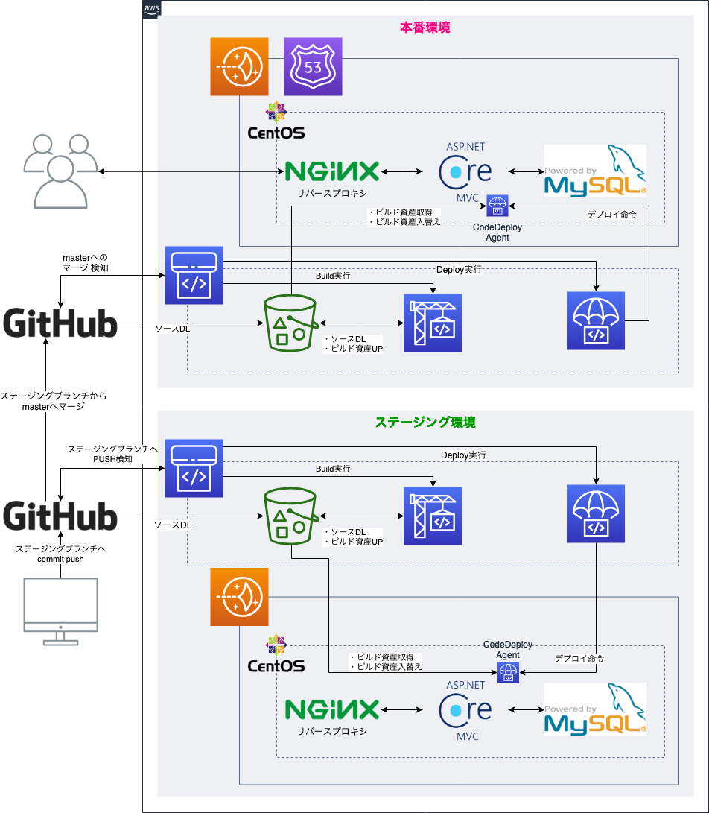

**既に本アプリはクローズしました。**

# Todo App

* やらないといけないけど中々やる気にならない  
  * 周りに宣言して逃げ場をなくそう。  
  掃除、洗濯、銀行へ行く、ご飯を作るなどTodoアプリを使うほどでもない軽いタスク
* 日常的に毎日見ているものだったらタスクの漏れぬけがなくなるだろう
  * Twitterだったら毎日見るし周りに宣言する要件も満たせる。

そこで、Twitter主体の生活をしている私ならではのTwitterを主体としたTodoアプリです。

Site：[３分間本気出す。]()

# 使用イメージ

下記のような形でTodoを管理することができます。

|||
|-|-|
|<blockquote class="twitter-tweet" data-lang="ja"><p lang="ja" dir="ltr">─[ ] 早起きする<a href="https://twitter.com/hashtag/3%E5%88%86%E9%96%93%E6%9C%AC%E6%B0%97%E5%87%BA%E3%81%99?src=hash&amp;ref_src=twsrc%5Etfw">#3分間本気出す</a></p>&mdash; あとらす (@Lychee_jam) <a href="https://twitter.com/Lychee_jam/status/1104055886798970880?ref_src=twsrc%5Etfw">2019年3月8日</a></blockquote>|<blockquote class="twitter-tweet" data-lang="ja"><p lang="ja" dir="ltr">─[🙃] 早起きする<a href="https://twitter.com/hashtag/3%E5%88%86%E9%96%93%E6%9C%AC%E6%B0%97%E5%87%BA%E3%81%99?src=hash&amp;ref_src=twsrc%5Etfw">#3分間本気出す</a></p>&mdash; あとらす (@Lychee_jam) <a href="https://twitter.com/Lychee_jam/status/1104235454168162304?ref_src=twsrc%5Etfw">2019年3月9日</a></blockquote>|

# 開発環境

## OS X

* Visual Studio for Mac or Visual Studio Code
* .NET Core 2.2 SDK
  * Template: ASP.NET Core MVC add Individual authentication
  ```sh
  $ dotnet new mvc -n hoge -au Individual
  ```
* Packages
  * CoreTweet Version:1.0.0.483
  * Pomelo.EntityFrameworkCore.MySql Version:2.2.0

## Windows

* VisualStudio 2017 Com

# インフラ構成
* AWS Lightsail $5プランを使用しています。
  * 1CPU、Mem 1G
* DNSはAWS Route 53を使用しています。
* WebサーバはNginxでリバースプロキシ + ASP.NET CoreデフォルトのKestrelの構成
* DBはMySQL 5.7を使用しています。
* AWS CodePipelineで自動ビルド・デプロイ環境構築済み
  * 構成：GitHub + CodeBuild + CodeDeploy
  * 本番/ステージングの２種類の環境構築しステージング検証→本番リリースとなる。


